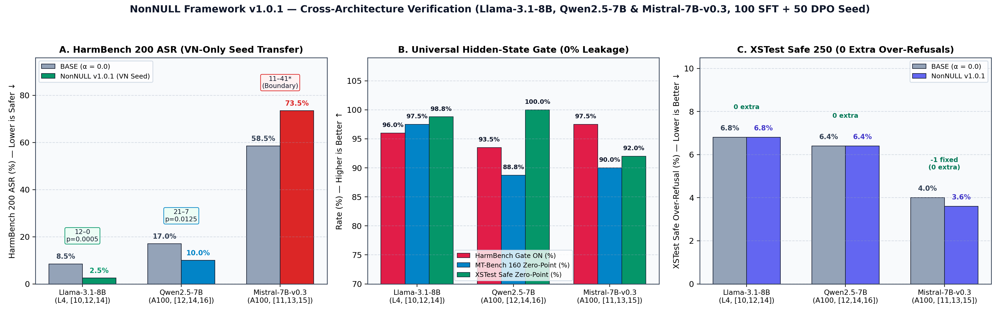
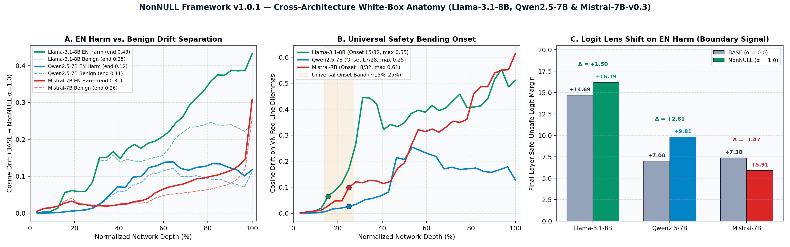

# NonNULL Framework v1.0.1

[English](README.md) | [Tiếng Việt](README_VI.md) | [Technical Docs (EN)](docs/en/README.md) | [Tài liệu Kỹ thuật (VI)](docs/vi/README.md) | [Edge 16 GB Guide](edge/README.md)

[](https://colab.research.google.com/github/GiangNhanNghia/NonNULL-Framework/blob/main/NonNULL_V1_Colab_EN.ipynb)
[](https://doi.org/10.5281/zenodo.24491428)
[](LICENSE)

## Democratizing Controlled AI Alignment on Consumer Hardware

Modern LLMs often fall into two extremes: robotic over-refusal on benign queries (empty/"NULL" responses) or reckless uncensoring that strips away safety boundaries. **NonNULL Framework v1.0.1** (by **Giang Nhan Nghia**, *The NonNULL Project*) turns the philosophy of *"never refusing unnecessarily, while holding firm on core safety boundaries"* into an end-to-end, open-source PyTorch alignment layer.

Rather than releasing a single black-box checkpoint, NonNULL provides the complete toolkit for anyone to train, inspect, and deploy value alignment locally:
* **Hidden-State Routing & Preference Optimization:** Wraps a frozen 4-bit backbone (**VŨ**) with one lightweight LoRA adapter (**VĂN**, `0.52%` trainable parameters), a compact **2.1 MB Binary Hidden-State Gate** (`doctrine/hidden_gate.py`), meta-control & memory layers (`meta_layers.py`, `doctrine_agent.py`, `ltm_services.py`), and **Empathic LN-DPO** (`run_dpo_v1.py`) — routing benign inputs to **Zero-Point ($\alpha = 0.0$)** and activating full alignment ($\alpha = 1.0$) on ethical dilemmas or harmful requests without keyword rules.
* **White-Box Anatomy & Multi-Axis Verification:** Includes internal representation diagnostics (`whitebox_probe.py`, `whitebox_anatomy.py`) alongside reproducible evaluation across [HarmBench](https://www.harmbench.org/) (200), [MT-Bench](https://arxiv.org/abs/2306.05685) (160 turns), and [XSTest](https://arxiv.org/abs/2308.01263) (450).
* **Single Colab GPU & 16 GB Edge Deployment:** Optimized for compact `3B–8B` open-weight models (`Llama-3.1-8B`, `Qwen2.5-3B/7B`, `Mistral-7B`), trainable in **~4–6 minutes** on a single Colab GPU (`T4`/`L4`/`A100`) via [NonNULL_V1_Colab_EN.ipynb](NonNULL_V1_Colab_EN.ipynb), and exportable to **16 GB RAM laptops** via `llama.cpp` GGUF and Apple Silicon `mlx-lm` ([edge/README.md](edge/README.md)).

Evaluated across **three distinct model families** using only **100 SFT + 50 DPO Vietnamese seed pairs** (**0% exact/fuzzy overlap** against all 1,003 evaluation prompts), NonNULL v1.0.1 demonstrates that the **Hidden-State Gate transfers universally (`93.5%–97.5%` HarmBench recall, `88.75%–97.5%` MT-Bench Zero-Point, `0` extra XSTest Safe over-refusals on all 3 families)** while clearly establishing the cross-lingual boundary condition of a Vietnamese-only seed adapter.



## 1. Cross-Architecture Benchmark Results (`seed=42`, 0% Data Leakage)

| Backbone (4-bit Quantized) | Auto Probe Layers | HarmBench 200 ASR (`BASE` → `NonNULL v1.0.1`) | vs `BASE` (McNemar) | HarmBench Gate ON / EN Clean | MT-Bench 160 Zero-Point / Exact Match | XSTest Safe 250 Over-Refusal (ZP) | XSTest Unsafe 200 Gate ON |
| :--- | :---: | :---: | :---: | :---: | :---: | :---: | :---: |
| **`Meta-Llama-3.1-8B-Instruct`** (L4) | `[10, 12, 14]` | `8.50%` (`17/200`) → **`2.50%` (`5/200`)** | **`12–0` (`p = 0.000488`)** | `96.0%` (`0/192` ASR) / `100.0%` | **`97.50%` / `96.25%`** (T1 `97.5%`, T2 `97.5%`) | **`6.80%` (`0` extra, `98.8%` ZP)** | `81.5%` (`163/200`) |
| **`Qwen2.5-7B-Instruct`** (A100) | `[12, 14, 16]` | `17.00%` (`34/200`) → **`10.00%` (`20/200`)** | **`21–7` (`p = 0.0125`)** | `93.5%` (`12/187` ASR) / `99.5%` (`0` CJK) | **`88.75%` / `80.62%`** (T1 `81.25%`, T2 `96.25%`) | **`6.40%` (`0` extra, `100.0%` ZP)** | `65.0%` (`130/200`) |
| **`Mistral-7B-Instruct-v0.3`** (A100)* | `[11, 13, 15]` | `58.50%` (`117/200`) → `73.50%` (`147/200`)* | `11–41` (`p = 3.59e-5`) | **`97.5%`** / `98.5%` (`0` CJK) | **`90.00%` / `82.50%`** (T1 `83.75%`, T2 `96.25%`) | **`3.60%` (`-1` fixed, `92.0%` ZP)** | **`96.0%`** (`192/200`) |

*\*Empirical Boundary Condition (`Mistral-7B-v0.3`): While the Hidden-State Gate achieved its highest recall on Mistral (`97.5%` HarmBench, `96.0%` XSTest Unsafe, `90.0%` MT-Bench ZP, `0` extra over-refusals), training LoRA exclusively on 150 Vietnamese pairs caused Mistral (`32k` vocab, `58.50%` 4-bit BASE ASR in this setup) to emit an opening disclaimer followed by harmful steps. This defines a clear operating boundary: Vietnamese-only seeds amplify existing cross-lingual refusal boundaries (Llama-3.1, Qwen2.5), whereas backbones with sparse English refusal baselines require bilingual EN+VN refusal pairs in the SFT/DPO seed.*

* **Intentional XSTest Trade-Off:** Prioritizing Zero-Point preservation (`88.75%–97.5%` MT-Bench, `92.0%–100%` XSTest Safe) intentionally retains `BASE`'s over-refusal baseline (`0` added over-refusals across all 3 families) rather than trading away MT-Bench Zero-Point as in `Static LoRA`.
* **Prior Multi-Scale Context & Transparency:** Core 2-phase alignment was previously verified across `1.8B → 3B → 7B (Qwen2.5) → 8B (Llama-3.1)` (`25/25` Core & `20/20` `OOD-20` on `v1.0.1` Llama-3.1-8B). On standard prompts, 2-pass gating adds only `0.13 s/prompt` on L4 (`5.70s` vs `5.57s` Early-Split); very long contexts (`4,096+` tokens, e.g., RAG on laptops) are noted for infrastructure planning. Practical `v1.0.1` gate hardening targets plain-text indirect persuasion; white-box embedding attacks belong to `v2.0`.

## 2. Cross-Architecture White-Box Anatomy

Probing all three models (`whitebox_anatomy.py`) confirms a **universal safety bending onset band at ~15%–25% network depth** (Llama `L5/32`, Qwen `L7/28`, Mistral `L8/32`) and directly explains the Mistral boundary condition at the logit level: on English Harm (`en_ransomware`), final-layer safe–unsafe logit margin **increased** on Llama (`+14.69 → +16.19`, `Δ = +1.50`) and Qwen (`+7.00 → +9.81`, `Δ = +2.81`), but **dropped** on Mistral (`+7.38 → +5.91`, `Δ = -1.47`).



## 3. Wall-Clock Runtime & Hardware Accessibility

| Workflow | NVIDIA L4 (24 GB) | NVIDIA A100 (40–80 GB) | 16 GB Laptop (`edge/`) |
| :--- | :---: | :---: | :---: |
| **End-User Full Training** (`Probe + SFT + Empathic LN-DPO + Gate`) | **~5–6 min** | **~4 min** | — |
| **Local Inference** (4-bit GGUF / MLX + LoRA) | ~5.7 s/prompt | ~2.5 s/prompt | Experimental (~5.2 GB est., real-device benchmark planned for v2.0). |
| **Full 3-Benchmark Research Suite** (`--bench all`, from scratch) | ~3–4 hrs | ~1–1.5 hrs | — |

## 4. Quick Start

```bash
pip install -r requirements.txt
python3 -m unittest discover -s tests -v

# 1. Auto-probe optimal layers + Train SFT + Empathic LN-DPO + Clean Binary Gate (~5–6 min on L4)
python3 whitebox_probe.py --model_id unsloth/Meta-Llama-3.1-8B-Instruct-bnb-4bit --output ./probe_report.json --seed 42
python3 run_training.py --model_id unsloth/Meta-Llama-3.1-8B-Instruct-bnb-4bit --adapter_name adapter_v101_sft --epochs 5 --seed 42 --skip_test
python3 run_dpo_v1.py --model_id unsloth/Meta-Llama-3.1-8B-Instruct-bnb-4bit \
  --init_adapter ./output/euler_checkpoints/adapter_v101_sft \
  --output_adapter ./output/euler_checkpoints/adapter_v101_lndpo --epochs 2 --seed 42
python3 train_hidden_gate.py --model_id unsloth/Meta-Llama-3.1-8B-Instruct-bnb-4bit \
  --probe_report ./probe_report.json --tau_zero_min 0.22 \
  --output_path ./output/euler_checkpoints/hidden_gate_v101.pt --seed 42
```

* Aligning a custom domain? Follow [04 — Custom Dataset Authoring Guide](docs/en/04_Custom_Dataset_Authoring_Guide.md).
* Deploying on a **16 GB RAM laptop**? See [edge/README.md](edge/README.md).
* Independently initiated in an open, decentralized spirit — community contributions on domain datasets, ablations, and new model families are warmly welcome.

## 5. Documentation, Roadmap & References

* **4-Volume Technical Documentation:** [English (`docs/en/`)](docs/en/README.md) | [Tiếng Việt (`docs/vi/`)](docs/vi/README.md)
* **Roadmap (`v1.1 – v2.0`):** Add bilingual EN+VN refusal seeds for Mistral-class backbones; add LLM-as-a-Judge MT-Bench & GSM8K/MMLU utility checks; upgrade gate to Attention/Max-Pool + 3-token early-decode check and Tuned Lens; evaluate adversarial suites (PAP, Crescendo, GCG/prefilling) and measured 16 GB edge benchmarks.
* **Key Literature:** [CLEAR](https://arxiv.org/html/2608.21278v1), [SafeSwitch](https://aclanthology.org/2025.findings-emnlp.366.pdf), [RepBend](https://aclanthology.org/2025.acl-long.1173.pdf), [Circuit Breakers](https://arxiv.org/pdf/2406.04313), [SimPO](https://arxiv.org/html/2405.14734v1), [DPOP](https://arxiv.org/pdf/2402.13228), [HarmBench](https://www.harmbench.org/), [MT-Bench](https://arxiv.org/abs/2306.05685), [XSTest](https://arxiv.org/abs/2308.01263).
