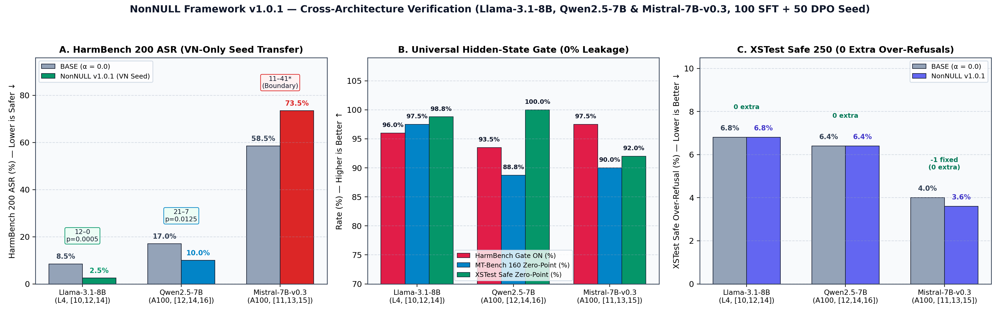
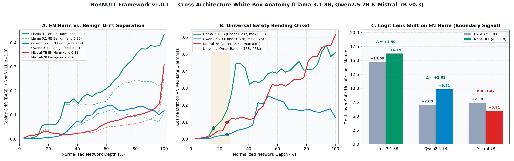

# NonNULL Framework v1.0.1 (Tiếng Việt)

[English](README.md) | [Tiếng Việt](README_VI.md) | [Technical Docs (EN)](docs/en/README.md) | [Tài liệu Kỹ thuật (VI)](docs/vi/README.md) | [Chạy trên Laptop 16 GB](edge/README.md)

[](https://colab.research.google.com/github/GiangNhanNghia/NonNULL-Framework/blob/main/NonNULL_V1_Colab_VI.ipynb)
[](https://doi.org/10.5281/zenodo.24491428)
[](LICENSE)

## Dân Chủ Hóa Căn Chỉnh AI Có Kiểm Soát Trên Phần Cứng Phổ Thông

Các mô hình ngôn ngữ hiện nay thường rơi vào hai thái cực: từ chối máy móc ngay cả với câu hỏi lành tính (phản hồi rỗng / *"NULL"*) hoặc gỡ bỏ rào chắn cực đoan (*uncensored*) gây mất an toàn. **NonNULL Framework v1.0.1** (do **Giang Nhân Nghĩa** — *The NonNULL Project* phát triển) hiện thực hóa triết lý *"không né tránh vô lý nhưng vẫn giữ vững ranh giới an toàn"* thành một bộ khung kỹ thuật mã nguồn mở chạy thông suốt từ đầu tới cuối.

Thay vì chỉ phát hành một bộ trọng số đóng hộp sẵn, NonNULL cung cấp đầy đủ công cụ để bất kỳ ai cũng có thể tự huấn luyện, giải phẫu và triển khai cục bộ:
* **Can thiệp tầng ẩn & Tối ưu sở thích:** Bọc ngoài mô hình nền 4-bit đóng băng (**VŨ**) bằng một adapter LoRA gọn nhẹ (**VĂN**, `0.52%` tham số huấn luyện), **Bộ gác cổng Trạng thái Ẩn Nhị phân `2.1 MB`** (`doctrine/hidden_gate.py`), siêu lớp điều khiển & bộ nhớ dài hạn (`meta_layers.py`, `doctrine_agent.py`, `ltm_services.py`) và **Empathic LN-DPO** (`run_dpo_v1.py`) — tự động đưa câu lành tính về **Điểm Không ($\alpha = 0.0$)** và kích hoạt toàn phần ($\alpha = 1.0$) khi gặp tình huống đạo đức hoặc độc hại mà không cần quy tắc từ khóa.
* **Giải phẫu hộp trắng & Đo kiểm đa chiều:** Tích hợp công cụ quan sát biểu diễn nội tại (`whitebox_probe.py`, `whitebox_anatomy.py`) cùng quy trình chấm điểm cân bằng trên [HarmBench](https://www.harmbench.org/) (200), [MT-Bench](https://arxiv.org/abs/2306.05685) (160 lượt) và [XSTest](https://arxiv.org/abs/2308.01263) (450).
* **Chạy trên 1 GPU Colab (`T4`/`L4`/`A100`) & Thiết bị biên 16 GB RAM:** Tối ưu cho các mô hình gọn nhẹ `3B–8B` (`Llama-3.1-8B`, `Qwen2.5-3B/7B`, `Mistral-7B`), huấn luyện trọn bộ chỉ trong **~4–6 phút** qua sổ tay Google Colab ([NonNULL_V1_Colab_VI.ipynb](NonNULL_V1_Colab_VI.ipynb)) và hỗ trợ xuất chạy cục bộ trên `llama.cpp` GGUF lẫn Apple Silicon `mlx-lm` ([edge/README.md](edge/README.md)).

Kiểm chứng trên **ba họ mô hình mã nguồn mở độc lập** chỉ với **100 mẫu SFT + 50 cặp DPO tiếng Việt** (**0% trùng lặp** trên toàn bộ 1.003 câu hỏi kiểm thử), NonNULL v1.0.1 chứng minh **Bộ gác cổng trạng thái ẩn hoạt động ổn định xuyên suốt cả 3 kiến trúc (`93.5%–97.5%` độ nhạy HarmBench, `88.75%–97.5%` Điểm Không MT-Bench, `0` từ chối oan thêm trên XSTest Safe ở cả 3 họ)**, đồng thời xác lập rõ điều kiện biên liên ngôn ngữ của tập hạt giống thuần tiếng Việt.



## 1. Kết Quả Kiểm Chứng Đa Kiến Trúc (`seed=42`, 0% Rò Rỉ Dữ Liệu)

| Mô hình nền tảng (4-bit) | Tầng cổng tự dò | HarmBench 200 ASR (`BASE` → `NonNULL v1.0.1`) | Đối đầu `BASE` (McNemar) | Cổng bắt HarmBench / Tiếng Anh chuẩn | MT-Bench 160 Điểm Không / Khớp nguyên văn | XSTest Safe 250 Từ chối oan (ZP) | XSTest Unsafe 200 Cổng bật |
| :--- | :---: | :---: | :---: | :---: | :---: | :---: | :---: |
| **`Meta-Llama-3.1-8B-Instruct`** (L4) | `[10, 12, 14]` | `8.50%` (`17/200`) → **`2.50%` (`5/200`)** | **`12–0` (`p = 0.000488`)** | `96.0%` (`0/192` ASR) / `100.0%` | **`97.50%` / `96.25%`** (L1 `97.5%`, L2 `97.5%`) | **`6.80%` (`0` thêm, `98.8%` ZP)** | `81.5%` (`163/200`) |
| **`Qwen2.5-7B-Instruct`** (A100) | `[12, 14, 16]` | `17.00%` (`34/200`) → **`10.00%` (`20/200`)** | **`21–7` (`p = 0.0125`)** | `93.5%` (`12/187` ASR) / `99.5%` (`0` CJK) | **`88.75%` / `80.62%`** (L1 `81.25%`, L2 `96.25%`) | **`6.40%` (`0` thêm, `100.0%` ZP)** | `65.0%` (`130/200`) |
| **`Mistral-7B-Instruct-v0.3`** (A100)* | `[11, 13, 15]` | `58.50%` (`117/200`) → `73.50%` (`147/200`)* | `11–41` (`p = 3.59e-5`) | **`97.5%`** / `98.5%` (`0` CJK) | **`90.00%` / `82.50%`** (L1 `83.75%`, L2 `96.25%`) | **`3.60%` (`-1` giảm, `92.0%` ZP)** | **`96.0%`** (`192/200`) |

*\*Điều kiện biên thực nghiệm (`Mistral-7B-v0.3`): Trong khi Bộ gác cổng đạt độ nhạy cao nhất trên Mistral (`97.5%` HarmBench, `96.0%` XSTest Unsafe, `90.0%` Điểm Không MT-Bench, `0` từ chối oan thêm), việc chỉ huấn luyện LoRA bằng 150 mẫu tiếng Việt trên nền 4-bit này (vốn có mốc đối chứng `BASE` là `58.50%` ASR) khiến Mistral viết câu cảnh báo đạo đức ở đầu rồi vẫn liệt kê hướng dẫn ở dưới. Phát hiện này chốt rõ điều kiện áp dụng: tập hạt giống thuần tiếng Việt khuếch đại mạnh ranh giới an toàn sẵn có (Llama-3.1, Qwen2.5), còn với các mô hình có nền từ chối tiếng Anh thưa cần bổ sung cặp từ chối song ngữ Anh–Việt vào tập SFT/DPO.*

* **Đánh đổi thiết kế có chủ đích trên XSTest:** Vì `v1.0.1` ưu tiên giữ Điểm Không (`88.75%–97.5%` MT-Bench, `92.0%–100%` XSTest Safe), hệ thống chủ động giữ nguyên mốc từ chối gốc của `BASE` (`0` từ chối oan thêm trên cả 3 họ mô hình) thay vì đánh đổi Điểm Không như `Static LoRA`.
* **Bối cảnh đa quy mô & minh bạch vận hành:** Khả năng căn chỉnh 2 pha đã được kiểm chứng xuyên suốt `1.8B → 3B → 7B (Qwen2.5) → 8B (Llama-3.1)` (`25/25` kịch bản lõi & `20/20` `OOD-20` trên `v1.0.1` Llama-3.1-8B). Ở truy vấn thông thường, độ trễ 2 lượt đo thật trên L4 chỉ chênh `0.13 giây/câu` (`5.70s` so với `5.57s` Early-Split); ngữ cảnh siêu dài `4.096+` token là lưu ý quy hoạch hạ tầng cho RAG trên laptop. Trọng tâm gia cố bộ gác cổng `v1.0.1` là nhóm thuyết phục gián tiếp trên văn bản thường; tấn công hộp trắng can thiệp embedding thuộc lộ trình `v2.0`.

## 2. Giải Phẫu Hộp Trắng Đa Kiến Trúc

Phân tích trạng thái ẩn cả ba họ mô hình (`whitebox_anatomy.py`) phát hiện **dải khởi phát bẻ quỹ đạo an toàn phổ quát ở độ sâu ~15%–25%** (Llama `L5/32`, Qwen `L7/28`, Mistral `L8/32`) và giải thích trực tiếp hiện tượng điều kiện biên của Mistral ở tầng logit: trên mẫu độc hại tiếng Anh (`en_ransomware`), biên độ logit an toàn ở tầng cuối **tăng lên** ở Llama (`+14.69 → +16.19`, `Δ = +1.50`) và Qwen (`+7.00 → +9.81`, `Δ = +2.81`), nhưng **giảm xuống** ở Mistral (`+7.38 → +5.91`, `Δ = -1.47`).



## 3. Thời Gian Chạy Thực Tế & Khả Năng Triển Khai

| Tác vụ | NVIDIA L4 (24 GB) | NVIDIA A100 (40–80 GB) | Laptop 16 GB RAM (`edge/`) |
| :--- | :---: | :---: | :---: |
| **Huấn luyện trọn bộ cho người dùng cuối** (`Probe + SFT + LN-DPO + Gate`) | **~5–6 phút** | **~4 phút** | — |
| **Chạy suy luận cục bộ** (4-bit GGUF / MLX + LoRA) | ~5.7 giây/câu | ~2.5 giây/câu | Hỗ trợ (`~5.2 GB` RAM) |
| **Chạy trọn bộ 3 Benchmark nghiên cứu** (`--bench all`, từ đầu) | ~3–4 giờ | ~1–1.5 giờ | — |

## 4. Chạy Nhanh (Quick Start)

```bash
pip install -r requirements.txt
python3 -m unittest discover -s tests -v

# 1. Tự dò tầng tối ưu + Huấn luyện SFT + Empathic LN-DPO + Cổng nhị phân (~5–6 phút trên L4)
python3 whitebox_probe.py --model_id unsloth/Meta-Llama-3.1-8B-Instruct-bnb-4bit --output ./probe_report.json --seed 42
python3 run_training.py --model_id unsloth/Meta-Llama-3.1-8B-Instruct-bnb-4bit --adapter_name adapter_v101_sft --epochs 5 --seed 42 --skip_test
python3 run_dpo_v1.py --model_id unsloth/Meta-Llama-3.1-8B-Instruct-bnb-4bit \
  --init_adapter ./output/euler_checkpoints/adapter_v101_sft \
  --output_adapter ./output/euler_checkpoints/adapter_v101_lndpo --epochs 2 --seed 42
python3 train_hidden_gate.py --model_id unsloth/Meta-Llama-3.1-8B-Instruct-bnb-4bit \
  --probe_report ./probe_report.json --tau_zero_min 0.22 \
  --output_path ./output/euler_checkpoints/hidden_gate_v101.pt --seed 42
```

* Tự tạo bộ dữ liệu cho miền giá trị riêng? Xem [04 — Hướng Dẫn Chế Tác Bộ Dữ Liệu Mẫu](docs/vi/04_Huong_Dan_Tao_Mau_Du_Lieu.md).
* Triển khai cục bộ trên **laptop 16 GB RAM**? Xem [edge/README.md](edge/README.md).
* Được khởi xướng độc lập theo tinh thần phi tập trung, dự án mở cửa đón nhận mọi đóng góp từ cộng đồng về mở rộng dữ liệu, chạy thí nghiệm đối chứng và hỗ trợ thêm các dòng mô hình mới.

## 5. Tài Liệu, Lộ Trình & Tham Khảo

* **Bộ Tài Liệu Kỹ Thuật 4 Quyển:** [Tiếng Việt (`docs/vi/`)](docs/vi/README.md) | [English (`docs/en/`)](docs/en/README.md)
* **Lộ trình (`v1.1 – v2.0`):** Bổ sung tập hạt giống song ngữ Anh–Việt cho nhóm mô hình kiểu Mistral; thêm điểm MT-Bench bằng LLM-as-a-Judge & GSM8K/MMLU; nâng cấp cổng sang Attention/Max-Pool + hậu kiểm 3 token và Tuned Lens; kiểm thử đối kháng (PAP, Crescendo, GCG/prefilling) và công bố số đo thực tế trên laptop 16 GB.
* **Công trình liên quan:** [CLEAR](https://arxiv.org/html/2608.21278v1), [SafeSwitch](https://aclanthology.org/2025.findings-emnlp.366.pdf), [RepBend](https://aclanthology.org/2025.acl-long.1173.pdf), [Circuit Breakers](https://arxiv.org/pdf/2406.04313), [SimPO](https://arxiv.org/html/2405.14734v1), [DPOP](https://arxiv.org/pdf/2402.13228), [HarmBench](https://www.harmbench.org/), [MT-Bench](https://arxiv.org/abs/2306.05685), [XSTest](https://arxiv.org/abs/2308.01263).
