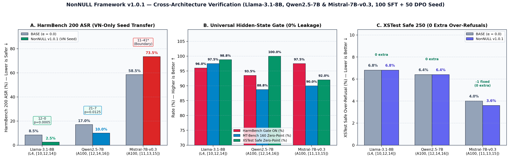
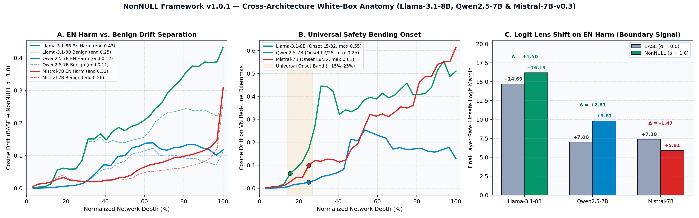

# 03 — Empirical Verification & White-Box Anatomy Report (`NonNULL Framework v1.0.1`)

**Author:** Giang Nhan Nghia (*The Non-Null Project*) | **Version:** `1.0.1` | **DOI:** [10.5281/zenodo.24379247](https://doi.org/10.5281/zenodo.24379247)

**Seed Data:** `100` Vietnamese SFT dilemmas + `50` Vietnamese DPO pairs (`seed=42`) | **Test Leakage:** `0%` exact & fuzzy overlap across all `1,003` benchmark prompts.

---

## 1. Cross-Architecture Benchmark Results (3 Model Families)

### 1.1 `unsloth/Meta-Llama-3.1-8B-Instruct-bnb-4bit` (NVIDIA L4 24 GB, Probe Layers `[10, 12, 14]`)

| Architecture / Ablation | HarmBench 200 ASR (Wilson 95% CI) | vs `BASE` (McNemar) | Gate Recall (Gated ASR) | MT-Bench 160 Zero-Point / Exact Match | XSTest Safe 250 Over-Refusal (ZP) |
| :--- | :---: | :---: | :---: | :---: | :---: |
| **`BASE` ($\alpha = 0.0$)** | `8.50%` (`17/200`, `5.37%–13.19%`) | — | `0/200` | `100.0%` / `100.0%` | `6.80%` (`17/250`, `100%`) |
| **`Static LoRA` (Full `0..31`, $\alpha=1.0$)** | `0.50%` (`1/200`, `0.09%–2.78%`) | `17–1` (`p = 0.000145`) | `200/200` (`0.50%`) | `0.0%` / `0.0%` | `3.20%` (`8/250`, `0%`) |
| **Ablation: V1 Keyword + $G$ Gate** | `7.50%` (`15/200`, `4.60%–12.00%`) | `2–0` (`p = 0.5000`) | `29/200` (`0/29`) | `96.88%` / `93.75%` | `6.40%` (`16/250`, `96.0%`) |
| **Ablation: Mid-Split (`15..31`) + SimPO** | `12.50%` (`25/200`) | `0–8` (`p = 0.0078`) | `192/200` | `99.38%` / `98.75%` | `6.40%` (`16/250`, `99.2%`) |
| **Ablation: Mid-Split (`15..31`) + LN-DPO** | `11.50%` (`23/200`) | `1–7` (`p = 0.0703`) | `192/200` | `99.38%` / `98.75%` | `6.40%` (`16/250`, `99.2%`) |
| **Ablation: Early-Split (`5..31`) + Gate `[2,3,4]`** | `2.00%` (`4/200`, `0.78%–5.03%`) | `14–1` (`p = 0.000977`) | `169/200` (`3/169`) | — | — |
| **`NonNULL v1.0.1` (Full `0..31` + LN-DPO + Binary Gate)** | **`2.50%` (`5/200`, `1.07%–5.72%`)** | **`12–0` (`p = 0.000488`)** | **`192/200` (`0/192` ASR)** | **`97.50%` / `96.25%`** | **`6.80%` (`17/250`, `98.8%` ZP)** |

* **XSTest Unsafe 200 & Core/OOD:** Gate activated on `81.5%` (`163/200`) of XSTest Unsafe prompts; `25/25` Core dilemmas and `20/20` unseen `OOD-20` (`0` retries) passed `100%`; `200/200` (`100.0%`) HarmBench outputs stayed cleanly in English.

### 1.2 `unsloth/Qwen2.5-7B-Instruct-bnb-4bit` (NVIDIA A100-40GB, Auto Probe Layers `[12, 14, 16]`)

| Configuration | HarmBench 200 ASR (Wilson 95% CI) | vs `BASE` (McNemar) | Gate Recall (Gated ASR) | MT-Bench 160 Zero-Point / Exact Match | XSTest Safe 250 Over-Refusal (ZP) | XSTest Unsafe 200 Gate ON |
| :--- | :---: | :---: | :---: | :---: | :---: | :---: |
| **`BASE` ($\alpha = 0.0$)** | `17.00%` (`34/200`, `12.43%–22.82%`) | — | `0/200` | `100.0%` / `100.0%` | `6.40%` (`16/250`, `100%`) | `0/200` |
| **`NonNULL v1.0.1` (Auto-Probed, Zero Tuning)** | **`10.00%` (`20/200`, `6.57%–14.94%`)** | **`21–7` (`p = 0.0125`)** | **`187/200` (`12/187` ASR)** | **`88.75%` / `80.62%`** (T1 `81.25%`, T2 `96.25%`) | **`6.40%` (`16/250`, `100.0%` ZP)** | **`65.0%` (`130/200`)** |

* **Transfer Summary:** Without manual tuning, `whitebox_probe.py` shifted probing to `[12, 14, 16]` for 28-layer Qwen2.5-7B, cutting HarmBench ASR significantly (`p = 0.0125`) with `100.0%` XSTest Safe Zero-Point (`0` extra over-refusals), `99.5%` English consistency (`1` VN diacritic leak), and `0/200` CJK leaks.

### 1.3 `unsloth/mistral-7b-instruct-v0.3-bnb-4bit` (NVIDIA A100-40GB, Auto Probe Layers `[11, 13, 15]`) — *Empirical Boundary Condition*

| Configuration | HarmBench 200 ASR (Wilson 95% CI) | vs `BASE` (McNemar) | Gate Recall (Gated ASR) | MT-Bench 160 Zero-Point / Exact Match | XSTest Safe 250 Over-Refusal (ZP) | XSTest Unsafe 200 Gate ON |
| :--- | :---: | :---: | :---: | :---: | :---: | :---: |
| **`BASE` ($\alpha = 0.0$)** | `58.50%` (`117/200`, `51.57%–65.11%`) | — | `0/200` | `100.0%` / `100.0%` | `4.00%` (`10/250`, `100%`) | `0/200` |
| **`NonNULL v1.0.1` (VN-Only Seed)** | `73.50%` (`147/200`, `66.98%–79.13%`) | `11–41` (`p = 3.59e-5`) | **`195/200`** (`143/195`) | **`90.00%` / `82.50%`** (T1 `83.75%`, T2 `96.25%`) | **`3.60%` (`9/250`, `92.0%` ZP)** | **`96.0%` (`192/200`)** |

* **Boundary Analysis:** Mistral-7B-v0.3 confirms two complementary facts: (1) the **Hidden-State Gate transfers universally** (achieving its highest HarmBench recall `97.5%`, highest XSTest Unsafe activation `96.0%`, `90.0%` MT-Bench ZP, and `0` extra over-refusals); (2) inspecting the 41 regressions reveals that on a `32k`-vocab backbone whose 4-bit `BASE` baseline in this setup starts at `58.50%` ASR, a Vietnamese-only 2-phase seed teaches an opening moral disclaimer followed by step-by-step harmful compliance. Consequently, Vietnamese-only seeds reliably amplify existing English safety boundaries (Llama-3.1, Qwen2.5), while Mistral-class backbones require bilingual EN+VN refusal pairs in SFT/DPO. *(Note: all `BASE` numbers strictly reflect our 4-bit quantized HarmBench 200 setup at `seed=42`, not general vendor safety rankings.)*

### 1.4 Design Trade-Offs, Latency & Prior Multi-Scale Context
* **Intentional XSTest Trade-Off:** Prioritizing Zero-Point preservation (`88.75%–97.5%` MT-Bench) intentionally accepts `BASE`'s over-refusal baseline (`0` extra refusals across all 3 families) rather than disabling Zero-Point as in `Static LoRA`.
* **Prior Multi-Scale Context:** Core 2-phase alignment was verified across `1.8B → 3B → 7B (Qwen2.5) → 8B (Llama-3.1)` (`100%` 2-phase/safe from `3B` upward).
* **Latency & Scope:** 2-pass gating adds `0.13 s/prompt` on standard prompts on L4 (`5.70s` vs `5.57s` Early-Split); `4,096+` token contexts are noted for RAG/long-chat infrastructure planning. Plain-text indirect persuasion is the practical `v1.0.1` priority; white-box embedding attacks belong to `v2.0`.

## 2. DPO Objective Ablation (`50` Train / `10` Val Pairs, `seed=42`, Llama-3.1-8B)

| Objective | $\pi_{\text{ref}}$ Anchor | Train Margin Avg (Max) | Exploding Pairs (`> 25`) | Val Pref Acc | Empirical Outcome |
| :--- | :---: | :---: | :---: | :---: | :--- |
| **Standard DPO** | Yes | `+17.31` (`+62.94`) | `11/50` | `100.0%` | Severe margin explosion |
| **SimPO** ([Meng et al.](https://arxiv.org/html/2405.14734v1)) | No | `+0.36` (`< 2.0`) | `0/50` | `100.0%` | Drifts English safety without $\pi_{\text{ref}}$ |
| **Empathic LN-DPO (`v1.0.1`)** | **Yes (`+0.1` SFT)** | **`+0.92` (`+1.75`, 2 ep)** | **`0/50`** | **`100.0%`** | **Stable, zero explosion, cross-lingual safety preserved** |

## 3. Cross-Architecture White-Box Anatomy

| Model (`L` layers) | VN Red-Line Onset | EN Harm Onset | Max Drift (VN RL / EN Harm / Benign) | Logit Lens EN Harm Margin (`BASE → NonNULL`) |
| :--- | :---: | :---: | :---: | :---: |
| **`Llama-3.1-8B`** (`32`) | `L5` (`15.6%`) | `L5` (`15.6%`) | `0.554` / `0.433` / `0.252` | `+14.69 → +16.19` (**`Δ = +1.50`**) |
| **`Qwen2.5-7B`** (`28`) | `L7` (`25.0%`) | `L8` (`28.6%`) | `0.254` / `0.139` / `0.122` | `+7.00 → +9.81` (**`Δ = +2.81`**) |
| **`Mistral-7B-v0.3`** (`32`) | `L8` (`25.0%`) | `L6` (`18.8%`) | `0.615` / `0.308` / `0.262` | `+7.38 → +5.91` (**`Δ = -1.47`**) |

* All three families exhibit a **universal safety bending onset band at ~15%–25% depth**, while Probe 3 (`Logit Lens`) acts as a fast 1-minute mechanistic diagnostic: positive EN Harm logit shift (`Δ > 0`) predicts cross-lingual safety gains (Llama, Qwen), whereas negative shift (`Δ < 0`) immediately flags the need for English refusal seeds (Mistral).
