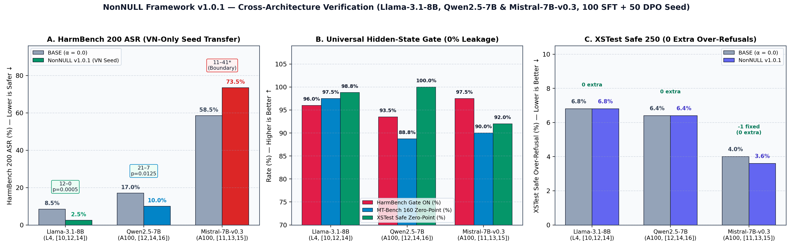
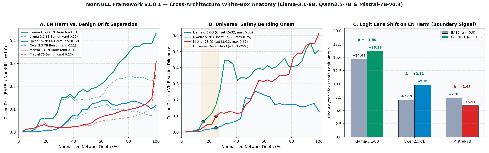

# 03 — Báo Cáo Kiểm Chứng Thực Nghiệm & Giải Phẫu Hộp Trắng (`NonNULL Framework v1.0.1`)

**Tác giả:** Giang Nhân Nghĩa (*The Non-Null Project*) | **Phiên bản:** `1.0.1` | **DOI:** [10.5281/zenodo.24379247](https://doi.org/10.5281/zenodo.24379247)

**Dữ liệu hạt giống:** `100` tình huống SFT tiếng Việt + `50` cặp DPO tiếng Việt (`seed=42`) | **Rò rỉ kiểm thử:** `0%` trùng khớp chính xác & khớp mờ trên toàn bộ `1.003` câu hỏi chuẩn.

---

## 1. Kết Quả Kiểm Chứng Đa Kiến Trúc (3 Họ Mô Hình)

### 1.1 `unsloth/Meta-Llama-3.1-8B-Instruct-bnb-4bit` (NVIDIA L4 24 GB, Tầng cổng `[10, 12, 14]`)

| Kiến trúc / Phép thử đối chứng | HarmBench 200 ASR (Wilson 95% CI) | Đối đầu `BASE` (McNemar) | Độ nhạy Cổng (ASR khi bật) | MT-Bench 160 Điểm Không / Khớp nguyên văn | XSTest Safe 250 Từ chối oan (ZP) |
| :--- | :---: | :---: | :---: | :---: | :---: |
| **`BASE` ($\alpha = 0.0$)** | `8.50%` (`17/200`, `5.37%–13.19%`) | — | `0/200` | `100.0%` / `100.0%` | `6.80%` (`17/250`, `100%`) |
| **`Static LoRA` (Full `0..31`, $\alpha=1.0$)** | `0.50%` (`1/200`, `0.09%–2.78%`) | `17–1` (`p = 0.000145`) | `200/200` (`0.50%`) | `0.0%` / `0.0%` | `3.20%` (`8/250`, `0%`) |
| **Đối chứng: Cổng từ khóa + $G$ (V1)** | `7.50%` (`15/200`, `4.60%–12.00%`) | `2–0` (`p = 0.5000`) | `29/200` (`0/29`) | `96.88%` / `93.75%` | `6.40%` (`16/250`, `96.0%`) |
| **Đối chứng: Mid-Split (`15..31`) + SimPO** | `12.50%` (`25/200`) | `0–8` (`p = 0.0078`) | `192/200` | `99.38%` / `98.75%` | `6.40%` (`16/250`, `99.2%`) |
| **Đối chứng: Mid-Split (`15..31`) + LN-DPO** | `11.50%` (`23/200`) | `1–7` (`p = 0.0703`) | `192/200` | `99.38%` / `98.75%` | `6.40%` (`16/250`, `99.2%`) |
| **Đối chứng: Early-Split (`5..31`) + Gate `[2,3,4]`** | `2.00%` (`4/200`, `0.78%–5.03%`) | `14–1` (`p = 0.000977`) | `169/200` (`3/169`) | — | — |
| **`NonNULL v1.0.1` (Full `0..31` + LN-DPO + Cổng nhị phân)** | **`2.50%` (`5/200`, `1.07%–5.72%`)** | **`12–0` (`p = 0.000488`)** | **`192/200` (`0/192` ASR)** | **`97.50%` / `96.25%`** | **`6.80%` (`17/250`, `98.8%` ZP)** |

* **XSTest Unsafe 200 & Kịch bản Lõi/OOD:** Cổng kích hoạt trên `81.5%` (`163/200`) câu XSTest Unsafe; `25/25` kịch bản lõi và `20/20` kịch bản mới `OOD-20` (`0` lần tự sửa) đạt `100%`; `200/200` (`100.0%`) câu trả lời HarmBench giữ hoàn toàn tiếng Anh chuẩn.

### 1.2 `unsloth/Qwen2.5-7B-Instruct-bnb-4bit` (NVIDIA A100-40GB, Tầng cổng tự dò `[12, 14, 16]`)

| Cấu hình | HarmBench 200 ASR (Wilson 95% CI) | Đối đầu `BASE` (McNemar) | Độ nhạy Cổng (ASR khi bật) | MT-Bench 160 Điểm Không / Khớp nguyên văn | XSTest Safe 250 Từ chối oan (ZP) | XSTest Unsafe 200 Cổng bật |
| :--- | :---: | :---: | :---: | :---: | :---: | :---: |
| **`BASE` ($\alpha = 0.0$)** | `17.00%` (`34/200`, `12.43%–22.82%`) | — | `0/200` | `100.0%` / `100.0%` | `6.40%` (`16/250`, `100%`) | `0/200` |
| **`NonNULL v1.0.1` (Tự dò tầng, không chỉnh tay)** | **`10.00%` (`20/200`, `6.57%–14.94%`)** | **`21–7` (`p = 0.0125`)** | **`187/200` (`12/187` ASR)** | **`88.75%` / `80.62%`** (L1 `81.25%`, L2 `96.25%`) | **`6.40%` (`16/250`, `100.0%` ZP)** | **`65.0%` (`130/200`)** |

* **Tóm tắt chuyển đổi:** Không chỉnh tay bất kỳ tham số nào, `whitebox_probe.py` tự động dịch cụm tầng thăm dò lên `[12, 14, 16]` cho Qwen2.5-7B (28 tầng), giảm độc hại có ý nghĩa thống kê (`p = 0.0125`), đạt `100.0%` Điểm Không trên XSTest Safe (`0` từ chối oan thêm), `99.5%` chuẩn tiếng Anh (`1` câu lẫn dấu Việt) và `0/200` rò rỉ chữ Trung.

### 1.3 `unsloth/mistral-7b-instruct-v0.3-bnb-4bit` (NVIDIA A100-40GB, Tầng cổng tự dò `[11, 13, 15]`) — *Điều Kiện Biên Thực Nghiệm*

| Cấu hình | HarmBench 200 ASR (Wilson 95% CI) | Đối đầu `BASE` (McNemar) | Độ nhạy Cổng (ASR khi bật) | MT-Bench 160 Điểm Không / Khớp nguyên văn | XSTest Safe 250 Từ chối oan (ZP) | XSTest Unsafe 200 Cổng bật |
| :--- | :---: | :---: | :---: | :---: | :---: | :---: |
| **`BASE` ($\alpha = 0.0$)** | `58.50%` (`117/200`, `51.57%–65.11%`) | — | `0/200` | `100.0%` / `100.0%` | `4.00%` (`10/250`, `100%`) | `0/200` |
| **`NonNULL v1.0.1` (Hạt giống thuần Việt)** | `73.50%` (`147/200`, `66.98%–79.13%`) | `11–41` (`p = 3.59e-5`) | **`195/200`** (`143/195`) | **`90.00%` / `82.50%`** (L1 `83.75%`, L2 `96.25%`) | **`3.60%` (`9/250`, `92.0%` ZP)** | **`96.0%` (`192/200`)** |

* **Phân tích điều kiện biên:** Kết quả trên Mistral-7B-v0.3 xác nhận hai sự thật song hành: (1) **Bộ gác cổng trạng thái ẩn có tính phổ quát cao trên cả 3 họ mô hình** (đạt đỉnh `97.5%` độ nhạy HarmBench, `96.0%` XSTest Unsafe, `90.0%` Điểm Không MT-Bench và `0` từ chối oan thêm); (2) khi soi 41 ca hồi quy, trên mô hình từ vựng `32k` có mốc đối chứng `BASE` ban đầu ở `58.50%` ASR trong thiết lập 4-bit này, tập hạt giống thuần tiếng Việt khiến Mistral học thói quen viết lời cảnh báo đạo đức ở đầu rồi vẫn liệt kê các bước độc hại ở dưới. Điều này chốt rõ phạm vi: hạt giống thuần Việt khuếch đại mạnh ranh giới an toàn sẵn có (Llama-3.1, Qwen2.5), còn với nhóm mô hình có nền từ chối tiếng Anh thưa cần bổ sung cặp từ chối song ngữ Anh–Việt vào tập SFT/DPO. *(Lưu ý: toàn bộ mốc `BASE` chỉ phản ánh phép đo thực nghiệm trong đúng thiết lập 4-bit trên 200 mẫu HarmBench Standard tại `seed=42`, không phải bảng xếp hạng an toàn tổng quát giữa các hãng.)*

### 1.4 Đánh Đổi Thiết Kế, Độ Trễ & Bối Cảnh Đa Quy Mô Tiền Nhiệm
* **Đánh đổi thiết kế có chủ đích trên XSTest:** Ưu tiên Điểm Không (`88.75%–97.5%` MT-Bench) đồng nghĩa chủ động giữ nguyên mốc từ chối gốc của `BASE` (`0` từ chối oan thêm ở cả 3 họ mô hình) thay vì đánh đổi Điểm Không như `Static LoRA`.
* **Bối cảnh đa quy mô tiền nhiệm:** Khả năng căn chỉnh 2 pha đã được kiểm chứng xuyên suốt `1.8B → 3B → 7B (Qwen2.5) → 8B (Llama-3.1)` (`100%` đạt 2 pha và an toàn từ `3B` trở lên).
* **Độ trễ & phạm vi bảo mật:** Cơ chế 2 lượt đo thật trên L4 chỉ tăng `0.13 giây/câu` ở truy vấn thường (`5.70s` so với `5.57s` Early-Split); ngữ cảnh siêu dài `4.096+` token là lưu ý quy hoạch hạ tầng cho RAG/hội thoại dài trên laptop. Ưu tiên thực tế của `v1.0.1` là nhóm thuyết phục gián tiếp trên văn bản thường; tấn công hộp trắng can thiệp embedding thuộc lộ trình `v2.0`.

## 2. Đối Chứng Hàm Mất Mát DPO (`50` Cặp Train / `10` Cặp Val, `seed=42`, Llama-3.1-8B)

| Phương pháp | Giữ neo $\pi_{\text{ref}}$ | Biên độ trung bình (Max) | Cặp nổ biên độ (`> 25`) | Độ chính xác Val | Kết quả thực nghiệm |
| :--- | :---: | :---: | :---: | :---: | :--- |
| **Standard DPO** | Có | `+17.31` (`+62.94`) | `11/50` | `100.0%` | Nổ biên độ nghiêm trọng |
| **SimPO** ([Meng et al.](https://arxiv.org/html/2405.14734v1)) | Không | `+0.36` (`< 2.0`) | `0/50` | `100.0%` | Trôi an toàn tiếng Anh do thiếu $\pi_{\text{ref}}$ |
| **Empathic LN-DPO (`v1.0.1`)** | **Có (`+0.1` SFT)** | **`+0.92` (`+1.75`, 2 ep)** | **`0/50`** | **`100.0%`** | **Ổn định, không nổ, bảo toàn an toàn liên ngôn ngữ** |

## 3. Giải Phẫu Hộp Trắng Đa Kiến Trúc

| Mô hình (`L` tầng) | Khởi phát Lằn ranh Đỏ VN | Khởi phát HarmBench EN | Độ lệch cực đại (VN RL / EN Harm / Benign) | Logit Lens EN Harm (`BASE → NonNULL`) |
| :--- | :---: | :---: | :---: | :---: |
| **`Llama-3.1-8B`** (`32`) | `L5` (`15.6%`) | `L5` (`15.6%`) | `0.554` / `0.433` / `0.252` | `+14.69 → +16.19` (**`Δ = +1.50`**) |
| **`Qwen2.5-7B`** (`28`) | `L7` (`25.0%`) | `L8` (`28.6%`) | `0.254` / `0.139` / `0.122` | `+7.00 → +9.81` (**`Δ = +2.81`**) |
| **`Mistral-7B-v0.3`** (`32`) | `L8` (`25.0%`) | `L6` (`18.8%`) | `0.615` / `0.308` / `0.262` | `+7.38 → +5.91` (**`Δ = -1.47`**) |

* Cả ba họ mô hình đều cho thấy **dải khởi phát bẻ quỹ đạo an toàn phổ quát ở ~15%–25% chiều sâu mạng**, đồng thời Probe 3 (`Logit Lens`) đóng vai trò công cụ chẩn đoán nhanh chỉ trong 1 phút: độ dịch logit dương trên EN Harm (`Δ > 0`) dự báo chuyển giao an toàn liên ngôn ngữ thành công (Llama, Qwen), trong khi độ dịch âm (`Δ < 0`) lập tức cảnh báo cần bổ sung mẫu từ chối tiếng Anh (Mistral).
